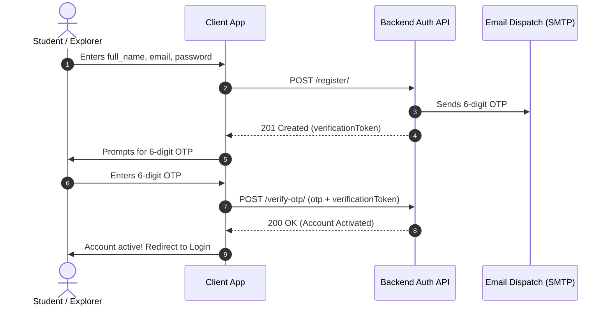
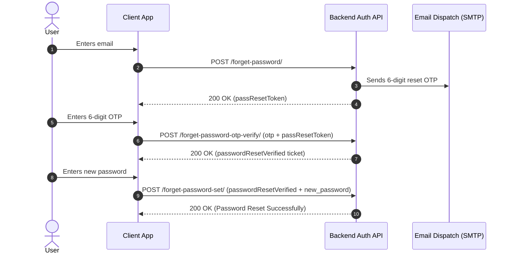

# Geography Geyser — Authentication API Integration Guide

This document contains the complete specification, request payloads, response schemas, and integration instructions for the **Geography Geyser Authentication API**. Use this guide to integrate authentication into mobile applications (Flutter, React Native, iOS, Android) or web frontend clients.

---

## 1. Global API Conventions

### Base URLs
- **Local Development**: `http://localhost:8000/api/v1/auth/` (Alias: `http://localhost:8000/auth/`)
- **Production / Staging**: `https://geographygeyser.tech/api/v1/auth/`

### Content Type & Headers
- All requests must include:
  ```http
  Content-Type: application/json
  Accept: application/json
  ```
- All protected endpoints must include:
  ```http
  Authorization: Bearer <access_token>
  ```

### Dual Token Compatibility
All token endpoints return both web and mobile keys for universal client compatibility:
- `access_token` and `access` (interchangeable access token strings)
- `refresh_token` and `refresh` (interchangeable refresh token strings)

---

## 2. Authentication Flow Diagrams

### Flow A: Registration & OTP Verification


### Flow B: Password Reset (3-Step Ticket Flow)


---

## 3. Detailed Endpoint Reference

### 3.1 Standard Login (Email & Password)
Authenticates existing users and returns JWT token pair with user profile.

- **Method**: `POST`
- **Path**: `/login/`
- **Full URL**: `http://localhost:8000/api/v1/auth/login/`
- **Authentication**: None (Public)

#### Request Payload
```json
{
  "email": "student@geographygeyser.com",
  "password": "SecurePassword123!"
}
```

#### Success Response (`200 OK`)
```json
{
  "access_token": "eyJhbGciOiJIUzI1NiIsInR5cCI6IkpXVCJ9...",
  "refresh_token": "eyJhbGciOiJIUzI1NiIsInR5cCI6IkpXVCJ9...",
  "access": "eyJhbGciOiJIUzI1NiIsInR5cCI6IkpXVCJ9...",
  "refresh": "eyJhbGciOiJIUzI1NiIsInR5cCI6IkpXVCJ9...",
  "email": "student@geographygeyser.com",
  "is_optional_module_selected": false,
  "user": {
    "id": "3fa85f64-5717-4562-b3fc-2c963f66afa6",
    "email": "student@geographygeyser.com",
    "full_name": "Jane Explorer"
  }
}
```

#### Error Responses
- `401 Unauthorized`:
  ```json
  {
    "detail": "No active account found with the given credentials",
    "code": "authentication_failed"
  }
  ```
- `400 Bad Request` (Account unverified):
  ```json
  {
    "message": "Please verify your email address before logging in.",
    "detail": "Account is not activated."
  }
  ```

---

### 3.2 Student Registration
Registers a new student account and triggers a 6-digit OTP email.

- **Method**: `POST`
- **Path**: `/register/`
- **Full URL**: `http://localhost:8000/api/v1/auth/register/`
- **Authentication**: None (Public)

#### Request Payload
```json
{
  "full_name": "Jane Explorer",
  "email": "jane@geographygeyser.com",
  "password": "SecurePassword123!"
}
```

#### Success Response (`201 Created`)
```json
{
  "success": true,
  "message": "Registration successful. Please verify the 6-digit OTP sent to your email.",
  "verificationToken": "abc123def456ghi789...",
  "user": {
    "id": "3fa85f64-5717-4562-b3fc-2c963f66afa6",
    "email": "jane@geographygeyser.com"
  }
}
```
> **Agent Implementation Note**: Store the returned `verificationToken` in memory/state and pass it to the OTP verification screen.

---

### 3.3 Verify Signup OTP
Validates the 6-digit OTP against the registration verification token and activates the account.

- **Method**: `POST`
- **Path**: `/verify-otp/`
- **Full URL**: `http://localhost:8000/api/v1/auth/verify-otp/`
- **Authentication**: None (Public)

#### Request Payload
```json
{
  "otp": "492015",
  "verificationToken": "abc123def456ghi789..."
}
```

#### Success Response (`200 OK`)
```json
{
  "success": true,
  "message": "OTP verified successfully. Account is now active."
}
```

#### Error Response (`400 Bad Request`)
```json
{
  "message": "Invalid or expired OTP verification code."
}
```

---

### 3.4 Forgot Password — Step 1: Request OTP
Dispatches a 6-digit password reset OTP to the user's registered email.

- **Method**: `POST`
- **Path**: `/forget-password/`
- **Full URL**: `http://localhost:8000/api/v1/auth/forget-password/`
- **Authentication**: None (Public)

#### Request Payload
```json
{
  "email": "student@geographygeyser.com"
}
```

#### Success Response (`200 OK`)
```json
{
  "success": true,
  "message": "6-digit passcode reset OTP sent to email.",
  "passResetToken": "reset_ticket_token_string_here",
  "user": {
    "email": "student@geographygeyser.com"
  }
}
```

---

### 3.5 Forgot Password — Step 2: Verify Reset OTP
Verifies the 6-digit reset code and exchanges `passResetToken` for an authorized `passwordResetVerified` ticket.

- **Method**: `POST`
- **Path**: `/forget-password-otp-verify/`
- **Full URL**: `http://localhost:8000/api/v1/auth/forget-password-otp-verify/`
- **Authentication**: None (Public)

#### Request Payload
```json
{
  "otp": "718293",
  "passResetToken": "reset_ticket_token_string_here"
}
```

#### Success Response (`200 OK`)
```json
{
  "success": true,
  "msg": "OTP verified successfully",
  "message": "OTP verified successfully",
  "passwordResetVerified": "verified_ticket_cryptographic_signature_here"
}
```

---

### 3.6 Forgot Password — Step 3: Set New Password
Applies the new password using the verified reset ticket.

- **Method**: `POST`
- **Path**: `/forget-password-set/`
- **Full URL**: `http://localhost:8000/api/v1/auth/forget-password-set/`
- **Authentication**: None (Public)

#### Request Payload
```json
{
  "passwordResetVerified": "verified_ticket_cryptographic_signature_here",
  "new_password": "NewStrongPassword456!"
}
```

#### Success Response (`200 OK`)
```json
{
  "success": true,
  "msg": "Password reset successfully!",
  "message": "Password reset successfully!"
}
```

---

### 3.7 Token Refresh
Rotates and issues a new access token using a valid refresh token. Supports both mobile (`refresh_token`) and web (`refresh`) property names.

- **Method**: `POST`
- **Path**: `/access-token/` (Alias: `/token/refresh/`)
- **Full URL**: `http://localhost:8000/api/v1/auth/access-token/`
- **Authentication**: None

#### Request Payload
```json
{
  "refresh_token": "eyJhbGciOiJIUzI1NiIsInR5cCI6IkpXVCJ9..."
}
```
*(Also accepts `{"refresh": "..."}`)*

#### Success Response (`200 OK`)
```json
{
  "access_token": "eyJhbGciOiJIUzI1NiIsInR5cCI6IkpXVCJ9...",
  "refresh_token": "eyJhbGciOiJIUzI1NiIsInR5cCI6IkpXVCJ9...",
  "access": "eyJhbGciOiJIUzI1NiIsInR5cCI6IkpXVCJ9...",
  "refresh": "eyJhbGciOiJIUzI1NiIsInR5cCI6IkpXVCJ9..."
}
```

---

### 3.8 Google Single Sign-On (SSO)
Authenticates or provisions a student account via verified Google identity.

- **Method**: `POST`
- **Path**: `/email/`
- **Full URL**: `http://localhost:8000/api/v1/auth/email/`
- **Authentication**: None (Public)

#### Request Payload
```json
{
  "email": "user@gmail.com"
}
```

#### Success Response (`200 OK`)
Returns standard JWT token pair and user profile (same as `/login/`).

---

### 3.9 Apple Sign-In
Authenticates with an Apple ID identity token.

- **Method**: `POST`
- **Path**: `/apple/`
- **Full URL**: `http://localhost:8000/api/v1/auth/apple/`
- **Authentication**: None (Public)

#### Request Payload
```json
{
  "id_token": "apple_identity_token_string",
  "user": {
    "name": {
      "firstName": "Alex",
      "lastName": "Mercer"
    }
  }
}
```

#### Success Response (`200 OK`)
Returns standard JWT token pair and user profile (same as `/login/`).

---

### 3.10 Current User Profile (`/me/`)
Fetches the profile and role details for the currently authenticated user.

- **Method**: `GET`
- **Path**: `/me/`
- **Full URL**: `http://localhost:8000/api/v1/auth/me/`
- **Authentication**: Required (`Bearer <access_token>`)

#### Success Response (`200 OK`)
```json
{
  "id": "3fa85f64-5717-4562-b3fc-2c963f66afa6",
  "email": "student@geographygeyser.com",
  "full_name": "Jane Explorer",
  "first_name": "Jane",
  "last_name": "Explorer",
  "is_optional_module_selected": false,
  "created_at": "2026-03-10T12:00:00Z",
  "updated_at": "2026-10-27T08:30:00Z"
}
```

---

### 3.11 In-App Password Update
Updates password from in-app settings after validating the current password.

- **Method**: `PATCH`
- **Path**: `/password-update/`
- **Full URL**: `http://localhost:8000/api/v1/auth/password-update/`
- **Authentication**: Required (`Bearer <access_token>`)

#### Request Payload
```json
{
  "old_password": "CurrentPassword123!",
  "new_password": "NewStrongPassword456!"
}
```

#### Success Response (`200 OK`)
```json
{
  "message": "Password updated successfully"
}
```

---

### 3.12 Logout (Token Revocation & Blacklist)
Revokes the submitted refresh token and adds it to the JWT blacklist.

- **Method**: `POST`
- **Path**: `/logout/`
- **Full URL**: `http://localhost:8000/api/v1/auth/logout/`
- **Authentication**: Required (`Bearer <access_token>`)

#### Request Payload
```json
{
  "refresh_token": "eyJhbGciOiJIUzI1NiIsInR5cCI6IkpXVCJ9..."
}
```
*(Also accepts `{"refresh": "..."}`)*

#### Success Response (`204 No Content`)
*Empty response body.*

---

### 3.13 Delete Account (Permanent)
Permanently deletes the user profile and all associated data after password confirmation.

- **Method**: `POST`
- **Path**: `/delete-account/`
- **Full URL**: `http://localhost:8000/api/v1/auth/delete-account/`
- **Authentication**: Required (`Bearer <access_token>`)

#### Request Payload
```json
{
  "password": "CurrentPassword123!"
}
```

#### Success Response (`200 OK`)
```json
{
  "message": "Account successfully deleted"
}
```

---

## 4. Agent Integration Instructions

When implementing client-side authentication for Geography Geyser, adhere to the following best practices:

### 1. Token Storage & Lifecycle
- Store `access_token` and `refresh_token` in **Secure Storage** (e.g. `flutter_secure_storage`, `expo-secure-store`, or `EncryptedSharedPreferences` / `Keychain`).
- Do not store tokens in unencrypted plain text `localStorage` or `AsyncStorage`.
- Store `user` object in app state (Zustand, Redux, Provider, or Riverpod).

### 2. Auto-Refresh Interceptor Pattern
Configure HTTP client interceptors (Axios / Dio / Fetch) to automatically handle `401 Unauthorized`:
1. Intercept `401` response.
2. Pause subsequent requests.
3. Call `POST /api/v1/auth/access-token/` with the stored `refresh_token`.
4. If refresh succeeds: update stored tokens, re-attach new `Bearer <access_token>`, and retry original request.
5. If refresh fails (token expired/blacklisted): purge tokens from secure storage and navigate user to login screen.

### 3. Multi-Step Ticket Preservation
- In **Registration**: Save `verificationToken` across screen transition from `RegisterScreen` to `OtpVerifyScreen`.
- In **Forgot Password**:
  1. Save `passResetToken` from step 1 to pass into step 2.
  2. Save `passwordResetVerified` from step 2 to pass into step 3.

---

## 5. Ready-to-Use Client Service Example (TypeScript)

```typescript
import axios from 'axios';

const BASE_URL = process.env.API_BASE_URL || 'http://localhost:8000/api/v1/auth';

export const authApi = axios.create({
  baseURL: BASE_URL,
  headers: {
    'Content-Type': 'application/json',
  },
});

// Auto-Refresh Interceptor
authApi.interceptors.response.use(
  (response) => response,
  async (error) => {
    const originalRequest = error.config;
    if (error.response?.status === 401 && !originalRequest._retry) {
      originalRequest._retry = true;
      try {
        const refreshToken = await getSecureToken('refresh_token');
        if (!refreshToken) throw new Error('No refresh token');

        const { data } = await axios.post(`${BASE_URL}/access-token/`, {
          refresh_token: refreshToken,
        });

        await saveSecureToken('access_token', data.access_token);
        originalRequest.headers['Authorization'] = `Bearer ${data.access_token}`;
        return authApi(originalRequest);
      } catch (refreshErr) {
        await clearSecureTokens();
        window.location.href = '/login';
        return Promise.reject(refreshErr);
      }
    }
    return Promise.reject(error);
  }
);
```

---

## 6. Testing Credentials for Local Development
- **Admin Investigator**:
  - Email: `admin@geographygeyser.com`
  - Password: `AdminPassword123!`
- **Sample Student**:
  - Email: `student@geographygeyser.com`
  - Password: `TestPassword123!`
